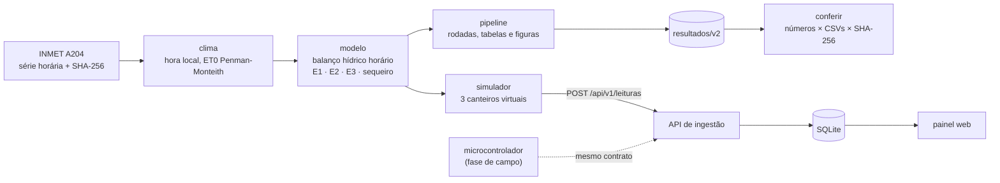
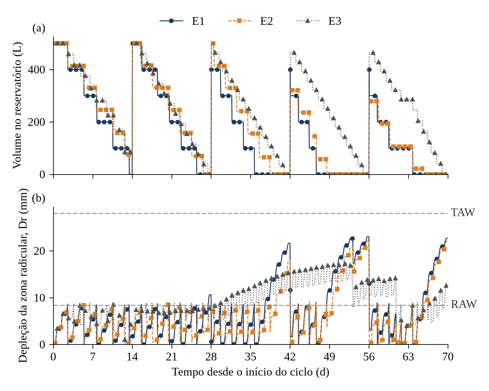

# Simulador de irrigação para hortas comunitárias

[](https://github.com/Erdeson-Monteiro/simulador-irrigacao-fapema/actions/workflows/ci.yml)

[](LICENSE)
[](LICENSE-TEXTOS-E-DADOS.md)

Simulação do manejo de irrigação de um canteiro de alface, com balanço hídrico horário do solo, evapotranspiração pelo método de Penman-Monteith (FAO-56) e dados meteorológicos reais do INMET. Inclui a API de ingestão e o painel que vão receber os dados do protótipo de campo.

Projeto de iniciação científica **"Automação da Irrigação em Hortas Comunitárias com Sensores e IoT"** (PIC/FAPEMA, Edital COORD.NUPEX nº 01/2026).
Autor: **Erdeson Monteiro Candeias** · Orientador: **Prof. Alex Rogaleski Marques**.

---

## Sumário

- [Visão geral](#visão-geral)
- [Resultados](#resultados)
- [Início rápido](#início-rápido)
- [Painel e API](#painel-e-api)
- [Reprodutibilidade](#reprodutibilidade)
- [Estrutura do repositório](#estrutura-do-repositório)
- [Dados](#dados)
- [Documentação](#documentação)
- [Como citar](#como-citar)
- [Licença](#licença)

## Visão geral

O simulador compara três regras de irrigação num canteiro de 10 m², hora a hora, ao longo de dois ciclos de 70 dias de 2023: um na estação chuvosa e outro na seca. A entrada é a série horária da estação automática **A204 do INMET (Balsas-MA)**.

| Regra | Como decide a irrigação |
|---|---|
| **E1, limiar fixo** | quando a umidade da zona radicular cai ao limiar, aplica uma lâmina fixa |
| **E2, reposição por balanço hídrico** | com o mesmo gatilho, repõe a depleção até a capacidade de campo |
| **E3, racionamento uniforme** | reparte a água do reservatório igualmente pelos dias até a próxima reposição |
| **Sequeiro** | não irriga; serve de referência para a percolação |

Cada regra roda em três cenários de oferta de água (reservatório de 1.000 L reposto a cada 3 dias, 500 L a cada 7 dias e 500 L a cada 14 dias).

**O que sustenta os resultados:**

- **Modelo físico do FAO-56**, implementado a partir das equações: ET0 horária (eq. 53), coeficiente de estresse Ks (eq. 84) e curva de Kc (eq. 66). A implementação reproduz o Exemplo 19 do FAO-56 nos testes.
- **Nenhum dado climático inventado.** O arquivo bruto é conferido pelo SHA-256, e qualquer falta de dado dentro de um ciclo interrompe a execução. Não há imputação nem série sintética.
- **Sem informação do futuro.** Cada regra decide no início da hora usando só o estado do fim da hora anterior. Um teste de não antecipação comprova isso.
- **Conservação de massa** verificada em todas as rodadas (erro de balanço < 10⁻⁶ mm).
- **Resultados auditáveis.** Cada número citado no artigo aponta para o arquivo, a linha e a coluna do CSV de origem, e o comando `conferir` relê todos eles.
- **Núcleo sem dependências.** O modelo usa só a biblioteca padrão do Python. `numpy` e `matplotlib` entram apenas nas figuras e no modelo v1.



O simulador e o microcontrolador de campo são fontes intercambiáveis da mesma API: quando o protótipo físico entrar em operação, ele envia leituras no mesmo formato e pelo mesmo endereço, e o restante do sistema não muda.

## Resultados

<p align="center">
  
</p>

<p align="center"><sub><b>Ciclo seco, cenário restrito.</b> (a) Volume no reservatório; (b) depleção da zona radicular (Dr), com os limites RAW (início do estresse) e TAW (ponto de murcha).</sub></p>

- **Com água abundante**, E1 e E2 mantêm a cultura sem estresse praticamente o tempo todo. E2 chega lá aplicando menos água e perdendo menos por percolação abaixo da zona radicular.
- **Com o reservatório restrito na seca**, nenhuma regra evita o estresse. E2 tem o maior tempo sem estresse. O racionamento uniforme (E3) troca um estresse curto e intenso por um longo e brando: tem o menor Dr máximo e o tanque fica vazio em menos dias.
- **Lâmina fixa maior não compensa.** Na regra E1, aumentar a lâmina acima de 10 mm não aumenta o tempo sem estresse, mas a percolação cresce quase linearmente (Figura 1 em [`resultados/v2/figuras/`](resultados/v2/figuras/)).
- **O "teto" de desempenho de E1 no modelo v1 vinha da medida diária.** No v1, E1 ficava bem abaixo de E2 com água abundante. Com decisão e medida horárias, as duas regras empatam; medidas por dia, as duas caem juntas (seção 8 do [relatório](resultados/v2/RELATORIO.md)).

Tabelas completas: [desempenho no ciclo chuvoso](resultados/v2/tabelas/tab_desempenho_chuvoso.md), [no ciclo seco](resultados/v2/tabelas/tab_desempenho_seco.md), [capacidade mínima do reservatório](resultados/v2/tabelas/tab_capacidade_minima.md) e [todas as demais](resultados/v2/tabelas/). Os números usados no artigo, com a origem de cada um, estão em [`NUMEROS_ARTIGO.md`](resultados/v2/NUMEROS_ARTIGO.md).

## Início rápido

Requer Python 3.12 ou mais recente (a versão fixada do `numpy` exige 3.12) e a fonte Liberation Serif para as figuras (`sudo apt install fonts-liberation` em Debian/Ubuntu).

```bash
git clone https://github.com/Erdeson-Monteiro/simulador-irrigacao-fapema.git
cd simulador-irrigacao-fapema
python3 -m venv .venv && source .venv/bin/activate
pip install -r requirements.txt

python3 main.py pipeline     # gera tudo em resultados/v2/ (cerca de 10 s)
python3 main.py conferir     # confere números, checksums e impressão digital do código
python3 -m unittest discover -s tests
```

| Comando | O que faz |
|---|---|
| `python3 main.py pipeline` | roda todas as simulações do v2 e gera tabelas, figuras, séries e documentos em `resultados/v2/`; também carrega o banco do painel (`--sem-banco` para pular) |
| `python3 main.py pipeline --modelo v1` | roda o modelo v1 (linha de base) e grava em `resultados/v1/` |
| `python3 main.py simular --ciclo chuvoso --cenario Abundante` | troca a simulação carregada no painel |
| `python3 main.py serve` | serve a API e o painel (não simula nada) |
| `python3 main.py dados [--preparar]` | mostra a situação dos dados externos e, com `--preparar`, extrai e registra os arquivos baixados |
| `python3 main.py conferir` | confere `NUMEROS_ARTIGO.md`, `CHECKSUMS.txt` e `AMBIENTE.md`; sai com código 1 se algo divergir |

## Painel e API

```bash
cp .env.example .env         # preencha DEVICE_TOKEN (o arquivo mostra como gerar um)
python3 main.py pipeline     # gera os resultados e popula o banco (padrão: ciclo seco, cenário restrito)
python3 main.py serve        # http://127.0.0.1:8000/
```

O painel mostra três canteiros virtuais (C1 = E1, C2 = E2, C3 = E3) com as leituras horárias do modelo, enviadas pela API de ingestão com o mesmo contrato e a mesma idempotência do microcontrolador de campo: umidade da camada 1 com o limiar, depleção com RAW e TAW, eventos de irrigação, nível do reservatório e um quadro-resumo por regra. A aba **Resultados do artigo** traz as tabelas e as figuras de `resultados/v2/`.

| Variável | Uso | Padrão |
|---|---|---|
| `DEVICE_TOKEN` | token do dispositivo `sim-001`; obrigatório no `serve` | — |
| `PORT` | porta HTTP; porta ocupada é erro, sem troca automática | `8000` |
| `HOST` | interface de escuta (`0.0.0.0` para a rede) | `127.0.0.1` |
| `DB_PATH` | banco SQLite | `data/irrigacao.db` |
| `CORS_ORIGIN` | única origem autorizada para CORS | vazio (só a própria origem) |

**Segurança.** O token nunca fica no código nem no git: o banco guarda só o SHA-256 dele, a comparação é feita em tempo constante e o token não aparece em log. Os tokens que estiveram no código do v1 são recusados. A API limita o corpo das requisições a 1 MB, restringe o CORS à origem configurada, usa SQLite em modo WAL e expõe `GET /healthz`. O contrato completo está em [`docs/CONTRATO_E_MODELO_DADOS.md`](docs/CONTRATO_E_MODELO_DADOS.md).

### Docker

```bash
cp .env.example .env         # defina DEVICE_TOKEN
docker compose up --build    # painel em http://localhost:8000/
```

A imagem parte de `python:3.12.3-slim-bookworm`, roda com usuário sem privilégios e tem `HEALTHCHECK` em `/healthz`. Na primeira subida, com o volume vazio, roda o pipeline e popula o banco; depois só serve.

## Reprodutibilidade

- **Determinístico.** Não há gerador aleatório. Os CSVs não contêm data, caminho absoluto nem hash de commit; os mesmos dados de entrada geram os mesmos arquivos, byte a byte.
- **Checksums.** [`CHECKSUMS.txt`](resultados/v2/CHECKSUMS.txt) guarda o SHA-256 de cada CSV gerado.
- **Impressão digital do código.** [`AMBIENTE.md`](resultados/v2/AMBIENTE.md) registra o SHA-256 do código, das dependências e dos dados brutos que geraram os resultados, além das versões do Python e das bibliotecas.
- **Parâmetros em cada saída.** Todo CSV do v2 começa com linhas `#` que registram o conteúdo, o arquivo climático (com SHA-256) e todos os parâmetros. Para ler no pandas: `pd.read_csv(caminho, comment="#")`.
- **Integração contínua.** A cada push, o [workflow de CI](.github/workflows/ci.yml) roda os testes e o `conferir`, gera tudo do zero e exige os mesmos checksums. Também constrói a imagem Docker.
- **Geração atômica.** O pipeline escreve numa pasta temporária e só substitui `resultados/v2/` se terminar sem erro.

## Estrutura do repositório

```text
.
├── main.py                  # linha de comando: pipeline, simular, serve, dados, conferir
├── src/
│   ├── v2/                  # modelo atual: FAO-56, leitura do INMET, balanço hídrico, pipeline, figuras
│   ├── api_server.py        # API de ingestão e consulta e painel (biblioteca padrão)
│   ├── database.py          # persistência em SQLite (esquema em schema.sql)
│   ├── seguranca.py         # tokens dos dispositivos
│   ├── static/index.html    # painel web
│   └── water_balance.py, climate.py, experiments.py, figures.py   # modelo v1 (linha de base)
├── tests/                   # FAO-56, não antecipação, conservação de massa, API e pipeline
├── data/raw/                # série horária do INMET e SHA256SUMS
├── resultados/
│   ├── v2/                  # tabelas, figuras, séries horárias e documentos do artigo
│   └── v1/                  # saídas do modelo v1, para a comparação v1 × v2
├── docs/                    # descrição do modelo, fontes dos parâmetros, contrato da API
└── .github/workflows/       # integração contínua
```

| Saída | Conteúdo |
|---|---|
| [`resultados/v2/tabelas/`](resultados/v2/tabelas/) | tabelas do artigo em CSV (ponto decimal) e Markdown (pt-BR) |
| [`resultados/v2/figuras/`](resultados/v2/figuras/) | Figuras 1 e 2 em PNG (300 dpi) e PDF, com os dados de cada uma em CSV |
| `resultados/v2/series/` | série horária de cada rodada (P, ET0, Kc, ETc, Ks, ETa, I, θ₁, θ₂, Dr, D₁, D₂, V) e o clima de cada ciclo; a pasta `varredura/` (144 rodadas) é recriada pelo pipeline |
| [`resultados/v2/RELATORIO.md`](resultados/v2/RELATORIO.md) | relatório gerado só com valores calculados |
| [`resultados/v2/NUMEROS_ARTIGO.md`](resultados/v2/NUMEROS_ARTIGO.md) | cada número do artigo, já formatado, com arquivo, linha e coluna de origem |
| [`resultados/v2/PENDENCIAS.md`](resultados/v2/PENDENCIAS.md) | itens marcados `[A CONFIRMAR PELO AUTOR]`, agrupados por assunto |
| [`resultados/v1/`](resultados/v1/) | tabelas, séries, figuras e relatório do modelo v1 |

## Dados

| Dado | Origem | SHA-256 |
|---|---|---|
| `data/raw/INMET_NE_MA_A204_BALSAS_01-01-2023_A_31-12-2023.CSV` | INMET, dados históricos anuais: https://portal.inmet.gov.br/uploads/dadoshistoricos/2023.zip | `7aa68f3a9a2c09ef19a822490fb5fe957c1e0b37bed7ca6b084e3e38d450b233` |
| Normal climatológica 1991–2020 (precipitação) | https://portal.inmet.gov.br/uploads/normais/Normal-Climatologica-PREC.xlsx → `data/raw/normais/` | registrado ao preparar |
| Dados de 2024 e 2025 da A204 | https://portal.inmet.gov.br/uploads/dadoshistoricos/2024.zip e `2025.zip` → `data/raw/downloads/` | registrados ao preparar |

O SHA-256 de cada arquivo bruto fica em [`data/raw/SHA256SUMS`](data/raw/SHA256SUMS); o modelo recusa arquivo fora do registro ou com hash diferente. A normal climatológica e os anos de 2024 e 2025 servem para contextualizar 2023 e ainda não foram baixados: enquanto isso, as tabelas correspondentes mostram `[A CONFIRMAR PELO AUTOR]`. Para incluí-los, baixe os três arquivos nas pastas indicadas e rode `python3 main.py dados --preparar` e `python3 main.py pipeline`.

## Documentação

| Documento | Conteúdo |
|---|---|
| [`docs/MODELO.md`](docs/MODELO.md) | equações, ordem do passo horário, o que cada regra sabe ao decidir, métricas, limitações e diferenças em relação ao v1 |
| [`docs/FONTES_PARAMETROS.md`](docs/FONTES_PARAMETROS.md) | fonte bibliográfica de cada parâmetro e premissas declaradas |
| [`docs/CONTRATO_E_MODELO_DADOS.md`](docs/CONTRATO_E_MODELO_DADOS.md) | modelo relacional e contrato HTTP/JSON da API de ingestão |

**Versões do modelo.** O **v2** (atual) tem passo horário, ET0 por Penman-Monteith, Ks e curva de Kc. O **v1**, com passo diário e ET0 por Hargreaves-Samani, é a linha de base avaliada no parecer do orientador de 18/10/2026. Ele continua no código e reproduzível, para a comparação v1 × v2, e o estado avaliado está preservado na tag [`v1-parecer`](https://github.com/Erdeson-Monteiro/simulador-irrigacao-fapema/tree/v1-parecer).

## Como citar

> CANDEIAS, Erdeson Monteiro; MARQUES, Alex Rogaleski. *Automação da Irrigação em Hortas Comunitárias com Sensores e IoT: simulador de manejo de irrigação*. PIC/FAPEMA, Edital COORD.NUPEX nº 01/2026, 2026. Software.

Os metadados de citação estão em [`CITATION.cff`](CITATION.cff); o GitHub os oferece no botão **Cite this repository**.

## Licença

- **Código:** Licença MIT ([`LICENSE`](LICENSE)).
- **Textos, figuras, tabelas e resultados:** Creative Commons Atribuição 4.0 (CC BY 4.0).
- **Dados meteorológicos brutos (`data/raw/`):** do INMET, sob os termos de uso do INMET, e devem ser citados como tal.

Detalhes em [`LICENSE-TEXTOS-E-DADOS.md`](LICENSE-TEXTOS-E-DADOS.md).
