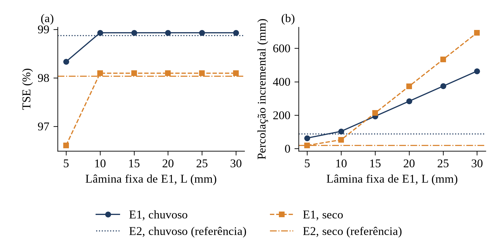

# Relatório de resultados do modelo v2

Projeto PIC/FAPEMA "Automação da Irrigação em Hortas Comunitárias com Sensores e IoT" (Edital COORD.NUPEX nº 01/2026). Autor: Erdeson Monteiro Candeias. Orientador: Prof. Alex Rogaleski Marques.

Gerado por `python3 main.py pipeline` em 31/10/2026. Todos os números saem dos resultados calculados; nada foi digitado. Modelo descrito em [`docs/MODELO.md`](../../docs/MODELO.md); números para citação em [`NUMEROS_ARTIGO.md`](NUMEROS_ARTIGO.md).

## 1. Dados

Série horária da estação automática A204 (BALSAS-MA) do INMET, arquivo `data/raw/INMET_NE_MA_A204_BALSAS_01-01-2023_A_31-12-2023.CSV`, SHA-256 `7aa68f3a9a2c09ef19a822490fb5fe957c1e0b37bed7ca6b084e3e38d450b233`; latitude -7,45556°, longitude -46,02750°, altitude 271,03 m, lidas do cabeçalho do arquivo. Nenhum dado foi estimado ou interpolado: os dois ciclos não têm falhas sem regra de tratamento (seção 2 de `docs/MODELO.md`).

**Clima dos ciclos (A204, Balsas-MA, 2023)**

| Variável | Chuvoso | Seco |
|---|---:|---:|
| Período (dias locais) | 15/01 a 25/03/2023 | 01/07 a 08/09/2023 |
| Horas | 1.680 | 1.680 |
| P (mm) | 299,2 | 42,2 |
| Normal 1991–2020 da janela (mm) | [A CONFIRMAR PELO AUTOR] | [A CONFIRMAR PELO AUTOR] |
| P/normal (%) | [A CONFIRMAR PELO AUTOR] | [A CONFIRMAR PELO AUTOR] |
| ΣET0 PM (mm) | 279,0 | 358,5 |
| ET0 PM média (mm/d) | 3,99 | 5,12 |
| ΣET0 HS (mm) | 357,4 | 409,4 |
| Viés HS em relação a PM (%) | +28,1 | +14,2 |
| ΣETc (mm) | 237,9 | 308,5 |
| T média do ar (°C) | 25,6 | 27,4 |
| u₂ médio (m/s) | 0,71 | 1,04 |
| Dias com chuva (P > 0) | 41 | 4 |
| Maior chuva diária (mm) | 77,8 (17/03) | 26,2 (31/08) |
| Maior chuva horária (mm) | 40,0 | 16,2 |

Viés = (ΣET0 HS − ΣET0 PM)/ΣET0 PM. ETc com a curva de Kc do FAO-56 (eq. 66). Dia local = UTC − 3. ET0 horária negativa zerada.  
A normal 1991–2020 não foi calculada: arquivo ausente; baixar de https://portal.inmet.gov.br/uploads/normais/Normal-Climatologica-PREC.xlsx para data/raw/normais/Normal-Climatologica-PREC.xlsx  
Abreviaturas: P = chuva; ET0 = evapotranspiração de referência; PM = Penman-Monteith horário (FAO-56, eq. 53); HS = Hargreaves-Samani (FAO-56, eq. 52), por dia local; ETc = Kc·ET0, evapotranspiração potencial da cultura; u₂ = vento a 2 m (eq. 47, anemômetro a 10 m).

- Ciclo chuvoso: Hargreaves-Samani dá 357,4 mm, contra 279,0 mm de Penman-Monteith (+28,1%).
- Ciclo seco: Hargreaves-Samani dá 409,4 mm, contra 358,5 mm de Penman-Monteith (+14,2%).

**Chuva dos ciclos de 2023 × normal climatológica 1991–2020 (Balsas-MA)**

| Ciclo | P 2023 (mm) | Normal 1991–2020 (mm) | P/normal (%) |
|---|---:|---:|---:|
| Chuvoso | 299,2 | [A CONFIRMAR PELO AUTOR] | [A CONFIRMAR PELO AUTOR] |
| Seco | 42,2 | [A CONFIRMAR PELO AUTOR] | [A CONFIRMAR PELO AUTOR] |

Normal da janela = soma proporcional por dias: chuvoso = jan × 17/31 + fev × 28/28 + mar × 25/31; seco = jul + ago + set × 8/30. Fonte: INMET, Normais climatológicas do Brasil 1991-2020 (2022).  
Normal não calculada: arquivo ausente; baixar de https://portal.inmet.gov.br/uploads/normais/Normal-Climatologica-PREC.xlsx para data/raw/normais/Normal-Climatologica-PREC.xlsx

A comparação com a normal 1991–2020 fica [A CONFIRMAR PELO AUTOR]: arquivo ausente; baixar de https://portal.inmet.gov.br/uploads/normais/Normal-Climatologica-PREC.xlsx para data/raw/normais/Normal-Climatologica-PREC.xlsx. Sem o arquivo, não se pode dizer se o ciclo chuvoso de 2023 foi atípico.

## 2. Parâmetros e cenários

**Parâmetros do modelo v2**

| Símbolo | Significado | Valor | Unidade | Fonte |
|---|---|---:|---|---|
| θcc | Umidade na capacidade de campo | 0,28 | cm³ cm⁻³ | FAO-56, Tabela 19 (solo franco: θcc 0,20–0,30; θpmp 0,07–0,17); página [A CONFIRMAR PELO AUTOR] |
| θpmp | Umidade no ponto de murcha permanente | 0,14 | cm³ cm⁻³ | FAO-56, Tabela 19 (solo franco: θcc 0,20–0,30; θpmp 0,07–0,17); página [A CONFIRMAR PELO AUTOR] |
| θsat | Umidade na saturação | 0,45 | cm³ cm⁻³ | premissa do modelo, sem efeito nas métricas (teste) |
| p | Fração da TAW esgotável sem estresse | 0,30 | — | FAO-56, Tabela 22 (alface, p = 0,30) |
| z₁ | Espessura da camada 1 (zona radicular efetiva, 0–20 cm) | 200,0 | mm | Marouelli et al. (2008), página [A CONFIRMAR PELO AUTOR]; FAO-56, Tabela 22 (0,3–0,5 m) |
| z₂ | Espessura da camada 2 (20–40 cm) | 200,0 | mm | premissa do modelo, sem efeito nas métricas (teste) |
| f_ext2 | Fração da ETa retirada da camada 2 | 0,0 | — | premissa do modelo |
| θ₁(0), θ₂(0) | Umidade inicial das camadas (perfil na capacidade de campo) | 0,28 | cm³ cm⁻³ | premissa do modelo |
| TAW | Água disponível total, (θcc − θpmp)·z₁ | 28,0 | mm | derivado (calculado pelo código) |
| RAW | Água facilmente disponível, p·TAW | 8,4 | mm | derivado (calculado pelo código) |
| θlim | Umidade em que Dr = RAW, θcc − p·(θcc − θpmp) | 0,238 | cm³ cm⁻³ | derivado (calculado pelo código) |
| Kc,ini | Coeficiente de cultura, fase inicial | 0,70 | — | FAO-56, Tabela 12 |
| Kc,mid | Coeficiente de cultura, fase média | 1,00 | — | FAO-56, Tabela 12 |
| Kc,end | Coeficiente de cultura, fim do ciclo | 0,95 | — | FAO-56, Tabela 12 |
| Lini/Ldev/Lmid/Llate | Duração das fases do Kc | 19/28/14/9 | d | FAO-56, Tabela 11 (alface 20/30/15/10 d), escalonada a 70 d |
| L | Lâmina fixa de E1 (sensibilidade de 5 a 30 mm) | 10,0 | mm | premissa do modelo |
| A | Área do canteiro (1 mm = 10 L) | 10 | m² | premissa do modelo |
| V / N | Capacidade e intervalo de reposição dos cenários | 1.000/3; 500/7; 500/14 | L / d | premissa de cenário |
| z_u | Altura do anemômetro | 10 | m | INMET, NT 001/2011 (mastro de 10 m); anemômetro no topo, premissa |

Derivados calculados pelo código. Fontes completas em docs/FONTES_PARAMETROS.md.

**Cenários de reservatório**

| Cenário | Capacidade (L) | Intervalo (d) | Oferta máxima (mm/d) | Reposições no ciclo | Oferta no ciclo (mm) |
|---|---:|---:|---:|---:|---:|
| Abundante | 1.000 | 3 | 33,3 | 24 | 2.400,0 |
| Moderado | 500 | 7 | 7,1 | 10 | 500,0 |
| Restrito | 500 | 14 | 3,6 | 5 | 250,0 |

Reservatório cheio às 00:00 do dia 1 e reposto às 00:00 dos dias 1 + N, 1 + 2N, …; área do canteiro de 10 m².  
Abreviaturas: Oferta = capacidade/(intervalo·área), em mm/d.

## 3. Desempenho das estratégias

Todas as estratégias decidem no início de cada hora com o estado do fim da hora anterior e recebem informação perfeita do estado do solo (seção 5 de `docs/MODELO.md`).

**Desempenho das estratégias, ciclo chuvoso (15/01 a 25/03/2023)**

| Cenário | Estr. | Aplicada (mm) | Acion. | Perc. incr. (mm) | Efic. (%) | TSE (%) | ETa/ETc (%) | Dr máx (mm) | Dias vazio |
|---|---|---:|---:|---:|---:|---:|---:|---:|---:|
| Abundante | E1 | 180,0 | 18 | 103,4 | 42,5 | 98,9 | 100,0 | 9,0 | 0 |
| Abundante | E2 | 164,0 | 19 | 88,0 | 46,3 | 98,9 | 100,0 | 9,0 | 0 |
| Abundante | E3 | 164,0 | 19 | 88,0 | 46,3 | 98,9 | 100,0 | 9,0 | 0 |
| Moderado | E1 | 180,0 | 18 | 103,4 | 42,5 | 98,9 | 100,0 | 9,0 | 0 |
| Moderado | E2 | 164,0 | 19 | 88,0 | 46,3 | 98,9 | 100,0 | 9,0 | 0 |
| Moderado | E3 | 158,9 | 19 | 82,9 | 47,8 | 98,9 | 100,0 | 9,0 | 0 |
| Restrito | E1 | 170,0 | 17 | 93,7 | 44,9 | 98,5 | 99,9 | 11,4 | 4 |
| Restrito | E2 | 162,0 | 19 | 86,1 | 46,9 | 98,9 | 100,0 | 9,0 | 1 |
| Restrito | E3 | 139,9 | 25 | 64,1 | 54,2 | 94,4 | 99,9 | 10,0 | 0 |
| — | Sequeiro | 0,0 | 0 | (145,3) | — | 39,2 | 71,2 | 24,8 | — |

Na linha do sequeiro, entre parênteses, a percolação total, que é a referência da percolação incremental.  
RAW = 8,4 mm; TAW = 28,0 mm; 1.680 horas.  
Abreviaturas: E1 = limiar fixo; E2 = reposição por balanço hídrico; E3 = racionamento uniforme; Acion. = acionamentos (horas com irrigação); Perc. incr. = percolação abaixo da zona radicular menos a do sequeiro do mesmo ciclo; Efic. = eficiência incremental, (aplicada − perc. incr.)/aplicada; TSE = tempo sem estresse hídrico, % das horas com Dr ≤ RAW no fim da hora; ETa = Ks·ETc, evapotranspiração real; Dr = depleção da zona radicular; Dias vazio = dias com o reservatório abaixo de 0,5 L no fim de alguma hora.

Com água sobrando (abundante, ciclo chuvoso), E1 fica com TSE de 98,9% e E2 com 98,9%; ETa/ETc de 100,0% e 100,0%. E1 aplica 180,0 mm e E2 164,0 mm; a percolação incremental é 103,4 e 88,0 mm.

**Desempenho das estratégias, ciclo seco (01/07 a 08/09/2023)**

| Cenário | Estr. | Aplicada (mm) | Acion. | Perc. incr. (mm) | Efic. (%) | TSE (%) | ETa/ETc (%) | Dr máx (mm) | Dias vazio |
|---|---|---:|---:|---:|---:|---:|---:|---:|---:|
| Abundante | E1 | 320,0 | 32 | 52,7 | 83,5 | 98,1 | 100,0 | 9,0 | 0 |
| Abundante | E2 | 285,1 | 33 | 19,3 | 93,2 | 98,0 | 100,0 | 9,1 | 0 |
| Abundante | E3 | 285,1 | 33 | 19,3 | 93,2 | 98,0 | 100,0 | 9,1 | 0 |
| Moderado | E1 | 320,0 | 32 | 52,7 | 83,5 | 98,1 | 100,0 | 9,0 | 0 |
| Moderado | E2 | 285,1 | 33 | 19,3 | 93,2 | 98,0 | 100,0 | 9,1 | 0 |
| Moderado | E3 | 297,9 | 36 | 25,1 | 91,6 | 97,9 | 100,0 | 9,1 | 0 |
| Restrito | E1 | 250,0 | 25 | 39,4 | 84,2 | 74,3 | 87,1 | 23,0 | 28 |
| Restrito | E2 | 242,6 | 27 | 19,8 | 91,9 | 79,3 | 90,9 | 22,2 | 19 |
| Restrito | E3 | 241,6 | 62 | 14,2 | 94,1 | 54,9 | 89,3 | 17,4 | 4 |
| — | Sequeiro | 0,0 | 0 | (6,7) | — | 6,4 | 19,5 | 28,0 | — |

Na linha do sequeiro, entre parênteses, a percolação total, que é a referência da percolação incremental.  
RAW = 8,4 mm; TAW = 28,0 mm; 1.680 horas.  
Abreviaturas: E1 = limiar fixo; E2 = reposição por balanço hídrico; E3 = racionamento uniforme; Acion. = acionamentos (horas com irrigação); Perc. incr. = percolação abaixo da zona radicular menos a do sequeiro do mesmo ciclo; Efic. = eficiência incremental, (aplicada − perc. incr.)/aplicada; TSE = tempo sem estresse hídrico, % das horas com Dr ≤ RAW no fim da hora; ETa = Ks·ETc, evapotranspiração real; Dr = depleção da zona radicular; Dias vazio = dias com o reservatório abaixo de 0,5 L no fim de alguma hora.

Com água sobrando (abundante, ciclo seco), E1 fica com TSE de 98,1% e E2 com 98,0%; ETa/ETc de 100,0% e 100,0%. E1 aplica 320,0 mm e E2 285,1 mm; a percolação incremental é 52,7 e 19,3 mm.

## 4. Sensibilidade de E1 à lâmina fixa (Figura 1)

**Sensibilidade de E1 à lâmina fixa (cenário abundante), com E2 como referência**

| Ciclo | Estr. | L (mm) | Aplicada (mm) | Acion. | Perc. incr. (mm) | Efic. (%) | TSE (%) | ETa/ETc (%) | Dr máx (mm) |
|---|---|---:|---:|---:|---:|---:|---:|---:|---:|
| Chuvoso | E1 | 5 | 140,0 | 28 | 63,1 | 54,9 | 98,3 | 100,0 | 9,1 |
| Chuvoso | E1 | 10 | 180,0 | 18 | 103,4 | 42,5 | 98,9 | 100,0 | 9,0 |
| Chuvoso | E1 | 15 | 270,0 | 18 | 193,4 | 28,4 | 98,9 | 100,0 | 9,0 |
| Chuvoso | E1 | 20 | 360,0 | 18 | 283,4 | 21,3 | 98,9 | 100,0 | 9,0 |
| Chuvoso | E1 | 25 | 450,0 | 18 | 373,4 | 17,0 | 98,9 | 100,0 | 9,0 |
| Chuvoso | E1 | 30 | 540,0 | 18 | 463,4 | 14,2 | 98,9 | 100,0 | 9,0 |
| Chuvoso | E2 | — | 164,0 | 19 | 88,0 | 46,3 | 98,9 | 100,0 | 9,0 |
| Seco | E1 | 5 | 285,0 | 57 | 19,1 | 93,3 | 96,6 | 100,0 | 9,2 |
| Seco | E1 | 10 | 320,0 | 32 | 52,7 | 83,5 | 98,1 | 100,0 | 9,0 |
| Seco | E1 | 15 | 480,0 | 32 | 212,7 | 55,7 | 98,1 | 100,0 | 9,0 |
| Seco | E1 | 20 | 640,0 | 32 | 372,7 | 41,8 | 98,1 | 100,0 | 9,0 |
| Seco | E1 | 25 | 800,0 | 32 | 532,7 | 33,4 | 98,1 | 100,0 | 9,0 |
| Seco | E1 | 30 | 960,0 | 32 | 692,7 | 27,8 | 98,1 | 100,0 | 9,0 |
| Seco | E2 | — | 285,1 | 33 | 19,3 | 93,2 | 98,0 | 100,0 | 9,1 |

Abreviaturas: E1 = limiar fixo; E2 = reposição por balanço hídrico; Acion. = acionamentos (horas com irrigação); Perc. incr. = percolação abaixo da zona radicular menos a do sequeiro do mesmo ciclo; Efic. = eficiência incremental, (aplicada − perc. incr.)/aplicada; TSE = tempo sem estresse hídrico, % das horas com Dr ≤ RAW no fim da hora; ETa = Ks·ETc, evapotranspiração real; Dr = depleção da zona radicular.

- Ciclo chuvoso: de L = 5 a 30 mm, o TSE de E1 varia de 98,3% a 98,9% e a percolação incremental de 63,1 a 463,4 mm; E2 tem 98,9% e 88,0 mm.
- Ciclo seco: de L = 5 a 30 mm, o TSE de E1 varia de 96,6% a 98,1% e a percolação incremental de 19,1 a 692,7 mm; E2 tem 98,0% e 19,3 mm.

Figura 1. Sensibilidade de E1 à lâmina fixa L no cenário abundante: (a) TSE; (b) percolação incremental. Linhas horizontais: E2.

## 5. Ciclo seco, cenário restrito (Figura 2)

| Estratégia | TSE (%) | ETa/ETc (%) | Dr máx (mm) | θ₁ mín | Acion. | Lâmina média (mm) | Aplicada (mm) | Dias vazio |
|---|---:|---:|---:|---:|---:|---:|---:|---:|
| E1 (limiar fixo) | 74,3 | 87,1 | 23,0 | 0,165 | 25 | 10,0 | 250,0 | 28 |
| E2 (reposição por balanço hídrico) | 79,3 | 90,9 | 22,2 | 0,169 | 27 | 9,0 | 242,6 | 19 |
| E3 (racionamento uniforme) | 54,9 | 89,3 | 17,4 | 0,193 | 62 | 3,9 | 241,6 | 4 |

θpmp = 0,14; RAW = 8,4 mm; TAW = 28,0 mm. Lâmina média = aplicada/acionamentos.

Maior TSE: E2. Maior ETa/ETc: E2. Menor Dr máximo: E3. Nenhuma estratégia leva θ₁ ao ponto de murcha: o menor θ₁ do ciclo é 0,165, acima de θpmp = 0,14, porque o Ks reduz a ETa à medida que o solo seca.

Figura 2. Ciclo seco, cenário restrito: (a) volume no reservatório; (b) depleção da zona radicular, com RAW e TAW. Série horária, marcador a cada 24 h.

## 6. Capacidade mínima do reservatório

**Capacidade mínima do reservatório para TSE ≥ 90%**

| Ciclo | Intervalo (d) | Estr. | Capacidade mínima | Oferta (mm/d) | TSE (%) | ETa/ETc (%) |
|---|---:|---|---:|---:|---:|---:|
| Chuvoso | 3 | E1 | 250 L | 8,3 | 98,9 | 100,0 |
| Chuvoso | 3 | E2 | 250 L | 8,3 | 98,9 | 100,0 |
| Chuvoso | 3 | E3 | 250 L | 8,3 | 98,9 | 100,0 |
| Chuvoso | 7 | E1 | 250 L | 3,6 | 98,9 | 100,0 |
| Chuvoso | 7 | E2 | 250 L | 3,6 | 98,9 | 100,0 |
| Chuvoso | 7 | E3 | 250 L | 3,6 | 97,1 | 100,0 |
| Chuvoso | 14 | E1 | 500 L | 3,6 | 98,5 | 99,9 |
| Chuvoso | 14 | E2 | 500 L | 3,6 | 98,9 | 100,0 |
| Chuvoso | 14 | E3 | 500 L | 3,6 | 94,4 | 99,9 |
| Seco | 3 | E1 | 250 L | 8,3 | 98,1 | 100,0 |
| Seco | 3 | E2 | 250 L | 8,3 | 98,0 | 100,0 |
| Seco | 3 | E3 | 250 L | 8,3 | 98,0 | 100,0 |
| Seco | 7 | E1 | 500 L | 7,1 | 98,1 | 100,0 |
| Seco | 7 | E2 | 500 L | 7,1 | 98,0 | 100,0 |
| Seco | 7 | E3 | 500 L | 7,1 | 97,9 | 100,0 |
| Seco | 14 | E1 | 750 L | 5,4 | 98,1 | 100,0 |
| Seco | 14 | E2 | 750 L | 5,4 | 98,0 | 100,0 |
| Seco | 14 | E3 | 750 L | 5,4 | 97,1 | 100,0 |

Varredura de 250 a 2.000 L, passo de 250 L. Capacidade mínima = menor capacidade da varredura com TSE ≥ 90%.  
Abreviaturas: TSE = tempo sem estresse hídrico, % das horas com Dr ≤ RAW no fim da hora; ETa = Ks·ETc, evapotranspiração real; Oferta = capacidade/(intervalo·área), em mm/d; E1 = limiar fixo; E2 = reposição por balanço hídrico; E3 = racionamento uniforme.

A varredura completa está em `tabelas/tab_varredura_reservatorio.md`.

## 7. Sensibilidade à profundidade radicular (z₁ = 300 mm)

**Sensibilidade à profundidade da zona radicular (z₁ = 200 mm × 300 mm)**

| Ciclo | Cenário | Estr. | TSE 200 | TSE 300 | ETa/ETc 200 | ETa/ETc 300 | Aplicada 200 | Aplicada 300 | Acion. 200 | Acion. 300 | Perc. incr. 200 | Perc. incr. 300 |
|---|---|---|---:|---:|---:|---:|---:|---:|---:|---:|---:|---:|
| Chuvoso | Abundante | E1 | 98,9 | 99,3 | 100,0 | 100,0 | 180,0 | 120,0 | 18 | 12 | 103,4 | 64,7 |
| Chuvoso | Abundante | E2 | 98,9 | 99,5 | 100,0 | 100,0 | 164,0 | 115,6 | 19 | 9 | 88,0 | 57,4 |
| Chuvoso | Abundante | E3 | 98,9 | 99,5 | 100,0 | 100,0 | 164,0 | 115,6 | 19 | 9 | 88,0 | 57,4 |
| Chuvoso | Moderado | E1 | 98,9 | 99,3 | 100,0 | 100,0 | 180,0 | 120,0 | 18 | 12 | 103,4 | 64,7 |
| Chuvoso | Moderado | E2 | 98,9 | 99,5 | 100,0 | 100,0 | 164,0 | 115,6 | 19 | 9 | 88,0 | 57,4 |
| Chuvoso | Moderado | E3 | 98,9 | 99,4 | 100,0 | 100,0 | 158,9 | 117,2 | 19 | 10 | 82,9 | 58,9 |
| Chuvoso | Restrito | E1 | 98,5 | 99,3 | 99,9 | 100,0 | 170,0 | 120,0 | 17 | 12 | 93,7 | 64,7 |
| Chuvoso | Restrito | E2 | 98,9 | 99,5 | 100,0 | 100,0 | 162,0 | 115,6 | 19 | 9 | 86,1 | 57,4 |
| Chuvoso | Restrito | E3 | 94,4 | 98,5 | 99,9 | 100,0 | 139,9 | 118,5 | 25 | 16 | 64,1 | 60,3 |
| Seco | Abundante | E1 | 98,1 | 98,3 | 100,0 | 100,0 | 320,0 | 280,0 | 32 | 28 | 52,7 | 25,8 |
| Seco | Abundante | E2 | 98,0 | 98,7 | 100,0 | 100,0 | 285,1 | 282,9 | 33 | 22 | 19,3 | 20,2 |
| Seco | Abundante | E3 | 98,0 | 98,7 | 100,0 | 100,0 | 285,1 | 282,9 | 33 | 22 | 19,3 | 20,2 |
| Seco | Moderado | E1 | 98,1 | 98,3 | 100,0 | 100,0 | 320,0 | 280,0 | 32 | 28 | 52,7 | 25,8 |
| Seco | Moderado | E2 | 98,0 | 98,7 | 100,0 | 100,0 | 285,1 | 282,9 | 33 | 22 | 19,3 | 20,2 |
| Seco | Moderado | E3 | 97,9 | 98,3 | 100,0 | 100,0 | 297,9 | 285,7 | 36 | 28 | 25,1 | 29,6 |
| Seco | Restrito | E1 | 74,3 | 80,9 | 87,1 | 93,9 | 250,0 | 240,0 | 25 | 24 | 39,4 | 19,5 |
| Seco | Restrito | E2 | 79,3 | 80,8 | 90,9 | 93,0 | 242,6 | 238,1 | 27 | 18 | 19,8 | 21,9 |
| Seco | Restrito | E3 | 54,9 | 58,8 | 89,3 | 90,8 | 241,6 | 239,0 | 62 | 59 | 14,2 | 14,6 |
| Chuvoso | — | Sequeiro | 39,2 | 51,5 | 71,2 | 80,8 | 0,0 | 0,0 | 0 | 0 | — | — |
| Seco | — | Sequeiro | 6,4 | 7,6 | 19,5 | 24,5 | 0,0 | 0,0 | 0 | 0 | — | — |

TSE e ETa/ETc em %; aplicada e percolação em mm. Com z₁ = 300 mm: TAW = 42,0 mm, RAW = 12,6 mm (com z₁ = 200 mm: 28,0 e 8,4 mm); L de E1 = 10 mm nos dois casos.  
Abreviaturas: TSE = tempo sem estresse hídrico, % das horas com Dr ≤ RAW no fim da hora; ETa = Ks·ETc, evapotranspiração real; Acion. = acionamentos (horas com irrigação); Perc. incr. = percolação abaixo da zona radicular menos a do sequeiro do mesmo ciclo; E1 = limiar fixo; E2 = reposição por balanço hídrico; E3 = racionamento uniforme.

- Ciclo chuvoso, abundante, z₁ = 300 mm: E1 com TSE de 99,3% e 12 acionamentos; E2 com 99,5% e 9. Como L = 10 mm é menor que RAW = 12,6 mm, cada acionamento de E1 não chega a repor a zona radicular até θcc.
- Ciclo seco, abundante, z₁ = 300 mm: E1 com TSE de 98,3% e 28 acionamentos; E2 com 98,7% e 22. Como L = 10 mm é menor que RAW = 12,6 mm, cada acionamento de E1 não chega a repor a zona radicular até θcc.

## 8. Comparação v1 × v2

**Comparação v1 × v2**

| Ciclo | Cenário | Estr. | Conforto v1 (% dias) | TSE v2 (% horas) | TSE diário v2 (% dias) | Aplicada v1 (mm) | Aplicada v2 (mm) | Acion. v1 | Acion. v2 | Perc. incr. v1 (mm) | Perc. incr. v2 (mm) |
|---|---|---|---:|---:|---:|---:|---:|---:|---:|---:|---:|
| Chuvoso | Abundante | E1 | 72,9 | 98,9 | 74,3 | 190,0 | 180,0 | 19 | 18 | 80,6 | 103,4 |
| Chuvoso | Abundante | E2 | 97,1 | 98,9 | 72,9 | 196,9 | 164,0 | 16 | 19 | 86,5 | 88,0 |
| Chuvoso | Abundante | E3 | 97,1 | 98,9 | 72,9 | 196,9 | 164,0 | 16 | 19 | 86,5 | 88,0 |
| Chuvoso | Moderado | E1 | 72,9 | 98,9 | 74,3 | 190,0 | 180,0 | 19 | 18 | 80,6 | 103,4 |
| Chuvoso | Moderado | E2 | 97,1 | 98,9 | 72,9 | 196,9 | 164,0 | 16 | 19 | 86,5 | 88,0 |
| Chuvoso | Moderado | E3 | 98,6 | 98,9 | 72,9 | 195,7 | 158,9 | 19 | 19 | 85,3 | 82,9 |
| Chuvoso | Restrito | E1 | 71,4 | 98,5 | 74,3 | 190,0 | 170,0 | 19 | 17 | 80,6 | 93,7 |
| Chuvoso | Restrito | E2 | 91,4 | 98,9 | 72,9 | 185,0 | 162,0 | 16 | 19 | 74,7 | 86,1 |
| Chuvoso | Restrito | E3 | 74,3 | 94,4 | 67,1 | 175,9 | 139,9 | 35 | 25 | 65,5 | 64,1 |
| Seco | Abundante | E1 | 50,0 | 98,1 | 54,3 | 350,0 | 320,0 | 35 | 32 | 18,3 | 52,7 |
| Seco | Abundante | E2 | 100,0 | 98,0 | 52,9 | 363,6 | 285,1 | 31 | 33 | 24,9 | 19,3 |
| Seco | Abundante | E3 | 100,0 | 98,0 | 52,9 | 363,6 | 285,1 | 31 | 33 | 24,9 | 19,3 |
| Seco | Moderado | E1 | 50,0 | 98,1 | 54,3 | 350,0 | 320,0 | 35 | 32 | 18,3 | 52,7 |
| Seco | Moderado | E2 | 100,0 | 98,0 | 52,9 | 363,4 | 285,1 | 31 | 33 | 24,8 | 19,3 |
| Seco | Moderado | E3 | 95,7 | 97,9 | 48,6 | 360,3 | 297,9 | 41 | 36 | 21,6 | 25,1 |
| Seco | Restrito | E1 | 27,1 | 74,3 | 41,4 | 240,0 | 250,0 | 24 | 25 | 24,7 | 39,4 |
| Seco | Restrito | E2 | 42,9 | 79,3 | 44,3 | 243,2 | 242,6 | 23 | 27 | 2,6 | 19,8 |
| Seco | Restrito | E3 | 25,7 | 54,9 | 11,4 | 241,7 | 241,6 | 64 | 62 | 4,1 | 14,2 |

Conforto v1 = % dos dias com θ₁ ≥ θlim no fim do dia (passo diário, p = 0,35). TSE diário v2 = mesma ideia de medida por dia, recalculada na série horária do v2.  
No v1 um acionamento é um dia com irrigação; no v2, uma hora com irrigação.  
Abreviaturas: TSE = tempo sem estresse hídrico, % das horas com Dr ≤ RAW no fim da hora; TSE diário = % dos dias sem nenhuma hora com Dr > RAW; Acion. = acionamentos (horas com irrigação); Perc. incr. = percolação abaixo da zona radicular menos a do sequeiro do mesmo ciclo; E1 = limiar fixo; E2 = reposição por balanço hídrico; E3 = racionamento uniforme.

- Ciclo chuvoso, abundante, E1: conforto v1 de 72,9% (1 − 19/70 dias = 72,9%); no v2, TSE de 98,9% das horas e TSE diário de 74,3% dos dias.
- Ciclo seco, abundante, E1: conforto v1 de 50,0% (1 − 35/70 dias = 50,0%); no v2, TSE de 98,1% das horas e TSE diário de 54,3% dos dias.

A coluna "TSE diário v2" aplica ao v2 uma medida por dia: basta uma hora com Dr > RAW para o dia contar como estressado. Com decisão horária, cada acionamento é precedido de uma hora de detecção com Dr > RAW, então a medida por dia rebaixa também E2: no ciclo chuvoso abundante, E2 tem TSE de 98,9% das horas e TSE diário de 72,9% dos dias; no ciclo seco abundante, E2 tem TSE de 98,0% das horas e TSE diário de 52,9% dos dias. A diferença entre "TSE v2" e "TSE diário v2" mostra quanto do "teto" de E1 no v1 vinha da medida por dia.

## 9. Correções em relação ao relatório do v1

1. **Seção 2.4 (confronto com normais).** O v1 anunciava o confronto e não o fazia. No v2 ele está na tabela de normal acima e fica [A CONFIRMAR PELO AUTOR] até o arquivo do INMET ser baixado.
2. **Seção 11 (percolação do sequeiro).** O texto fixo citava outro valor; a percolação do sequeiro no ciclo chuvoso calculada pelo v1 é 84,39 mm. No v2 ela é 145,34 mm.
3. **Seção 12.1 ("série sintética").** A menção foi retirada do gerador do v1. Todo resultado usa só o arquivo do INMET, conferido pelo SHA-256.
4. **Seções 12.2 e 12.3 (banda morta).** No v1, θlim correspondia a p·AD = 0,35 × 28,0 = 9,80 mm de depleção, mas E2/E3 só disparavam com déficit ≥ 10,0 mm. No v2 o gatilho é o próprio RAW = 8,4 mm, calculado, e a banda deixa de existir.
5. **Seção 13, item 3 (platô de E1).** O texto fixo do v1 situava o platô em outra faixa de lâminas. Calculado: no ciclo chuvoso, o conforto de E1 do v1 no cenário abundante chega ao máximo (80,0%) a partir de L = 20 mm; no ciclo seco, o conforto de E1 do v1 no cenário abundante chega ao máximo (70,0%) a partir de L = 20 mm.
6. **Seção 13, item 4 ("teto estrutural" de E1).** Ver seção 8: no v2 a regra de E1 é avaliada de hora em hora.
7. **"Nenhuma estratégia evitou o ponto de murcha".** No v2, com Ks, θ₁ não chega a θpmp em nenhuma rodada principal (menor θ₁: 0,165). O pior momento é descrito por Dr máx e ETa/ETc.

**Percolação de E1 no ciclo seco (seção 13, item 1, do v1).**

No v1, E1 percolava 24,69 mm no ciclo seco com o cenário restrito e 18,30 mm com o abundante, mesmo aplicando menos água (240,0 × 350,0 mm).
No v2 a anomalia não se repete: E1 percola 46,1 mm no restrito e 59,4 mm no abundante, aplicando 250,0 e 320,0 mm.

## 10. Diagnósticos

**Diagnósticos (grandezas que o modelo não aplica)**

| Diagnóstico | Unidade | Chuvoso | Seco |
|---|---|---:|---:|
| Kc,mid com o ajuste climático (eq. 62; h = 0,3 m) | — | 0,956 | 1,016 |
| Diferença para o Kc,mid da Tabela 12 | — | -0,044 | +0,016 |
| u₂ médio da fase média | m/s | 0,72 | 0,98 |
| URmin média da fase média | % | 54,4 | 26,6 |
| ETc diária mínima | mm/d | 0,91 | 3,04 |
| ETc diária máxima | mm/d | 5,26 | 6,09 |
| p ajustado pela ETc diária, mínimo | — | 0,29 | 0,26 |
| p ajustado pela ETc diária, máximo | — | 0,46 | 0,38 |
| Horas com ET0 horária negativa (zerada) | h | 694 | 706 |
| Soma da ET0 negativa zerada | mm | -8,23 | -14,16 |
| ΣET0 PM adotada (ω₁, ω₂ limitados a ±ωs) | mm | 279,0 | 358,5 |
| ΣET0 PM com Ra zerada pelo meio da hora (texto do FAO-56) | mm | 278,4 | 357,9 |
| Rs/Rso bruta máxima (horas com Ra > 1,5 MJ m⁻² h⁻¹) | — | 1,057 | 1,057 |
| Rs/Rso bruta, percentil 99 (mesmas horas) | — | 1,028 | 1,011 |
| Rs/Rso bruta máxima no ano (Ra > 1,5 MJ m⁻² h⁻¹) | — | 1,109 | 1,109 |
| Rs/Rso bruta, percentil 99 no ano | — | 1,021 | 1,021 |
| Horas do ano com Ra > 1,5 MJ m⁻² h⁻¹ | h | 3.165 | 3.165 |
| Dessas horas, com Rs/Rso bruta > 1 (limitadas a 1) | h | 100 | 100 |

Fase média do Kc: dias 48 a 61 do ciclo. p ajustado = 0,30 + 0,04·(5 − ETc), limitado a 0,1–0,8 (FAO-56, Tabela 22). As linhas "no ano" valem para 2023 inteiro e aparecem iguais nas duas colunas.

## 11. Anos vizinhos

**Completude da estação A204 nas janelas dos ciclos**

| Ano | Janela | Período | Dias | Completos | Parciais | Sem registro | Maior lacuna (d) | Horas válidas (%) |
|---:|---|---|---:|---:|---:|---:|---:|---:|
| 2023 | chuvoso | 15/01 a 25/03 | 70 | 70 | 0 | 0 | 0 | 100,0 |
| 2023 | seco | 01/07 a 08/09 | 70 | 70 | 0 | 0 | 0 | 100,0 |

Dia completo = 24 horas com todas as variáveis usadas no v2. Dia sem registro = nenhuma variável em nenhuma hora. Lacuna = dias consecutivos sem registro. Dias locais (UTC − 3); o último dia local do ano depende das 3 primeiras horas UTC do arquivo do ano seguinte.  
Dados horários de 2024, estação A204 (extraídos de 2024.zip): [A CONFIRMAR PELO AUTOR], arquivo ausente (baixar de https://portal.inmet.gov.br/uploads/dadoshistoricos/2024.zip para `data/raw/downloads/2024.zip`).  
Dados horários de 2025, estação A204 (extraídos de 2025.zip): [A CONFIRMAR PELO AUTOR], arquivo ausente (baixar de https://portal.inmet.gov.br/uploads/dadoshistoricos/2025.zip para `data/raw/downloads/2025.zip`).

**Conferência das afirmações sobre 2024 e 2025**

| Afirmação do artigo | Valor afirmado | Valor no arquivo do INMET | Confere? |
|---|---:|---:|---|
| 2024: dias sem registro na janela do ciclo seco (01/07 a 08/09) | 60 | [A CONFIRMAR PELO AUTOR] | [A CONFIRMAR PELO AUTOR] |
| 2024: maior lacuna contínua na janela do ciclo seco (dias) | 27 | [A CONFIRMAR PELO AUTOR] | [A CONFIRMAR PELO AUTOR] |
| 2025: sem registros de maio a dezembro | todos os dias | [A CONFIRMAR PELO AUTOR] | [A CONFIRMAR PELO AUTOR] |

Dias locais; "sem registro" = nenhuma variável em nenhuma hora do dia. Sem o arquivo do ano, a afirmação fica a confirmar (nada é estimado).

**Dados externos**

| Arquivo | Pasta de destino | URL | Situação |
|---|---|---|---|
| Normal climatológica 1991–2020, precipitação (planilha do INMET) | `data/raw/normais/Normal-Climatologica-PREC.xlsx` | https://portal.inmet.gov.br/uploads/normais/Normal-Climatologica-PREC.xlsx | ausente |
| Dados horários de 2024, estação A204 (extraídos de 2024.zip) | `data/raw/downloads/2024.zip` | https://portal.inmet.gov.br/uploads/dadoshistoricos/2024.zip | ausente |
| Dados horários de 2025, estação A204 (extraídos de 2025.zip) | `data/raw/downloads/2025.zip` | https://portal.inmet.gov.br/uploads/dadoshistoricos/2025.zip | ausente |

Arquivos ausentes não são estimados. Depois de baixá-los, rode `python3 main.py dados --preparar` e `python3 main.py pipeline`.

O objetivo (c) do artigo fica restrito a 2023; os outros anos só têm a completude conferida.

## 12. Limitações

Lista completa na seção 9 de `docs/MODELO.md`: um só ano; camada 2 sem extração; drenagem instantânea; sem escoamento superficial; parâmetros de literatura; informação perfeita; Kc sem ajuste climático; p fixo; ET0 negativa zerada; anemômetro assumido a 10 m.

## 13. Reprodutibilidade

Ambiente e tempo de execução em [`AMBIENTE.md`](AMBIENTE.md) (8,9 s nesta execução). SHA-256 de cada CSV em [`CHECKSUMS.txt`](CHECKSUMS.txt).

## 14. Arquivos

| Tabela (dados) | Tabela (formatada) |
|---|---|
| `tabelas/tab_afirmacoes_anos_vizinhos.csv` | `tabelas/tab_afirmacoes_anos_vizinhos.md` |
| `tabelas/tab_capacidade_minima.csv` | `tabelas/tab_capacidade_minima.md` |
| `tabelas/tab_cenarios.csv` | `tabelas/tab_cenarios.md` |
| `tabelas/tab_clima_ciclos.csv` | `tabelas/tab_clima_ciclos.md` |
| `tabelas/tab_comparacao_v1_v2.csv` | `tabelas/tab_comparacao_v1_v2.md` |
| `tabelas/tab_completude_anos.csv` | `tabelas/tab_completude_anos.md` |
| `tabelas/tab_dados_externos.csv` | `tabelas/tab_dados_externos.md` |
| `tabelas/tab_desempenho_chuvoso.csv` | `tabelas/tab_desempenho_chuvoso.md` |
| `tabelas/tab_desempenho_seco.csv` | `tabelas/tab_desempenho_seco.md` |
| `tabelas/tab_diagnosticos.csv` | `tabelas/tab_diagnosticos.md` |
| `tabelas/tab_normal_climatologica.csv` | `tabelas/tab_normal_climatologica.md` |
| `tabelas/tab_parametros.csv` | `tabelas/tab_parametros.md` |
| `tabelas/tab_sensibilidade_e1.csv` | `tabelas/tab_sensibilidade_e1.md` |
| `tabelas/tab_sensibilidade_z1.csv` | `tabelas/tab_sensibilidade_z1.md` |
| `tabelas/tab_varredura_reservatorio.csv` | `tabelas/tab_varredura_reservatorio.md` |

Séries horárias: 200 arquivos em `series/` (uma por rodada, mais o clima de cada ciclo).
